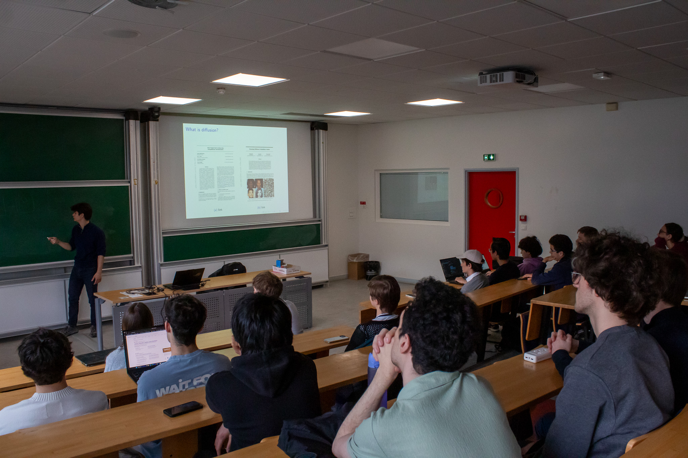
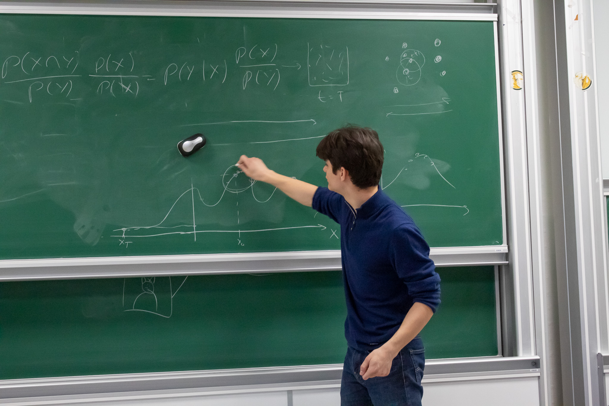

CSC is the Computer Science Committee of the Bachelor of École Polytechnique. The 10-person committee board organises Computer Science seminars, competitions and get-togethers for its 400+ members.

As vice president, I was responsible for coordinating with our school's administration in order to secure approvals and resources for our events. I was also actively engaged in the organisation of every event, by reaching out to speakers, writing challenges for competitions, helping on the ground on D-Day and taking photos.

You can find some of the things we were up to on our [LinkedIn](https://www.linkedin.com/company/cscommittee/posts/).

A highlight of my time at CSC (bxAI back then) was the opportunity of hosting my own seminar on Diffusion!

["Introduction to Diffusion"](https://www.linkedin.com/posts/bxai_ai-diffusionmodels-bxai-ugcPost-7320091607020539904-H9B7) covered the intuition and the mathematics of DDPM. Our first event in March 2025 (first year), as bxAI. My slides are available [here](Diffusion_Presentation.pdf).





As a prize for our beginning-of-year competition, and to attract new students, I made a CSC-themed circuit board with programmable light patterns.

")