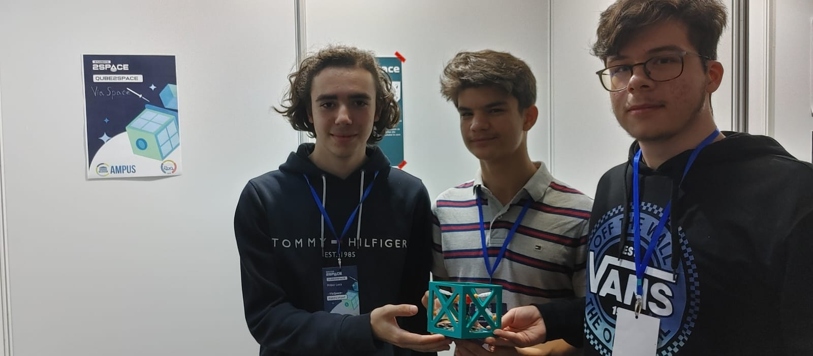
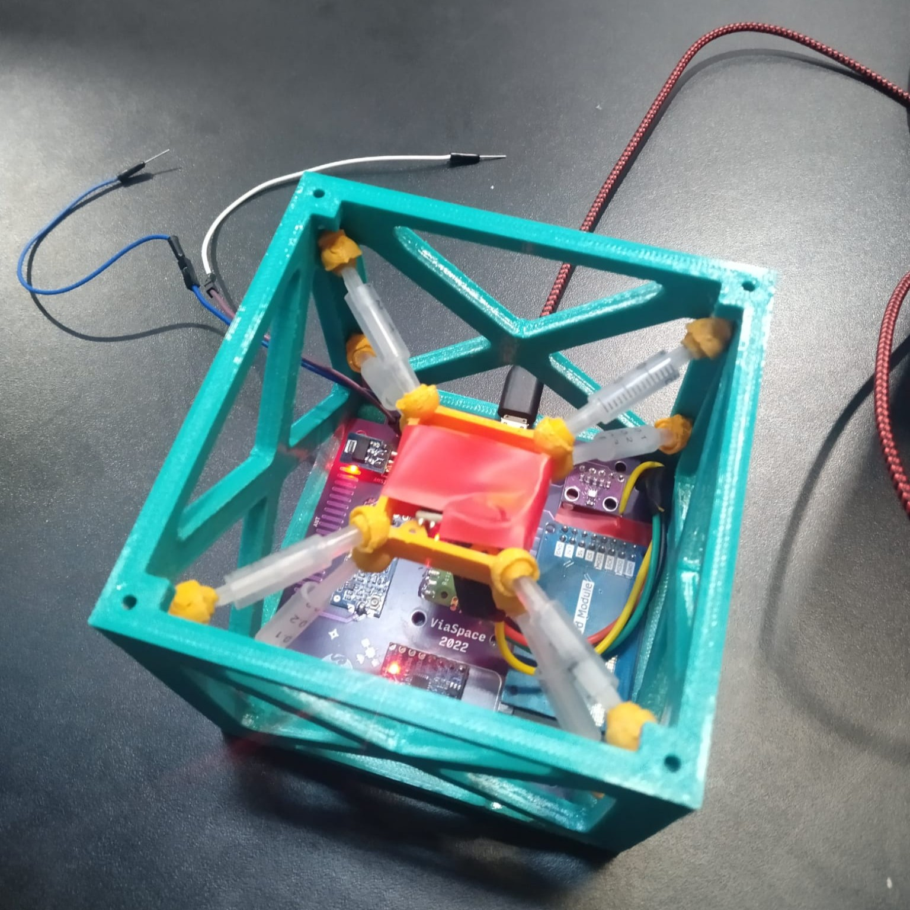

My team, ViaSpace, won the 1st Prize in the Cube2Space competition.

We were tasked with designing a scientific mission for a 1U cubesat to be launched on a student-built suborbital rocket.

During the final phase of the competition we had 2 days to build and test a proof of concept cubesat at the Polytechnic University of Bucharest.

The mission we designed consisted of testing a self-made vibration-dampening system during launch. We used IMUs to measure the movement of the rocket and dampened platform, and incorporated a radio transmitter for recovery of the payload.

I worked on designing the scientific mission and the structure of the cubesat.

