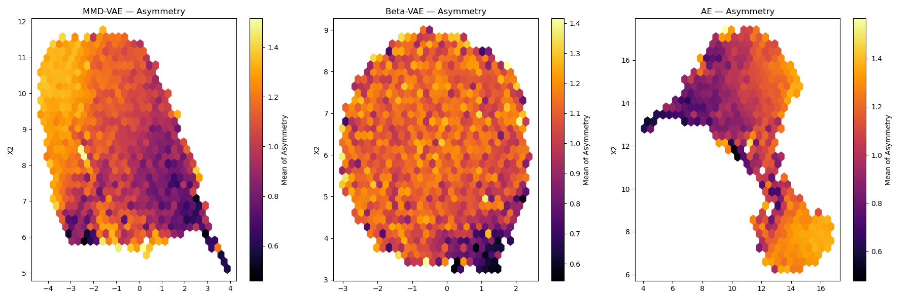
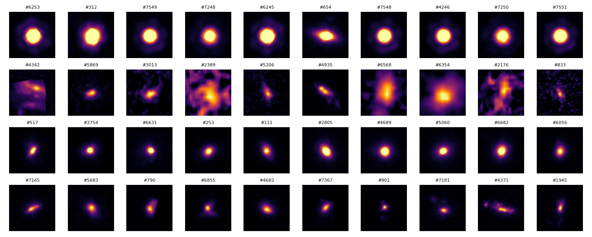
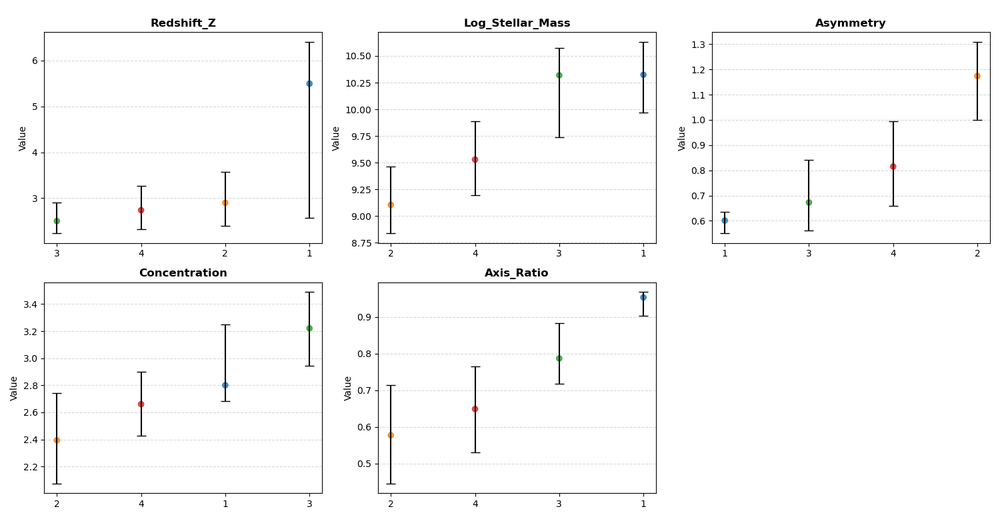

Galaxy classification is a well-studied subject. For close galaxies the Hubble sequence is used to classify them by shape, and can give us insight into the composition and formation. At high redshift (z > 2), we see much older, less well-formed galaxies. Shapes are irregular and clumpy, and their imaging is lower resolution. The Hubble sequence no longer applies, and there is currently no established classification in the literature.

Unsupervised learning is well suited to this challenge, as it can reveal hidden structure present in the data. This was investigated by [Tohill et al. (2023)](https://arxiv.org/abs/2306.17225), who trained a variational autoencoder on JWST/CEERS images and clustered its latent space. With Antonio Mateos-Belinchon and Maria Neagoie, I reproduced their analysis and extended it to the COSMOS-Web field observed by JWST.

Our work was done for the final project of the CSC_2S004_EP Machine Learning course at École Polytechnique.

## Our approach

- **Data reduction.** Reduced ~100 GB of JWST mosaics and catalogs to the relevant galaxies and their physical parameters: cross-matched catalogs, applied the paper's selection cuts (z > 2, log₁₀(M/M☉) > 8.5, no active galactic nuclei), and cut a stamp around each galaxy in the filter closest to its rest-frame V-band.
- **Cleaning.** The data is very noisy. Similar to the paper, we masked neighbouring sources, rotated and rescaled each galaxy to a common size, and filtered heavily to keep only clean data points. This left about 6,800 galaxies, close to the paper's 6,869.
- **Models.** Trained three models: a plain autoencoder, a β-VAE and the paper's MMD-VAE.
- **Clustering.** Analysed the latent spaces with dimensionality reduction (UMAP, t-SNE) and clustering (K-means, hierarchical clustering), and correlated the clusters with physical parameters.

 to the final standardised data used for training (bottom row).")

## Results

The latent dimensions correlate with physical parameters such as asymmetry and axis ratio.

Hierarchical clustering into 4 classes gives groups that correlate with measurable physical parameters.

There is recoverable structure even within very distant, early galaxies. Surprisingly, the simple autoencoder works very well, compared to the paper's MMD-VAE.

Presented our work in a [defense](MLdefense_final.pdf).
