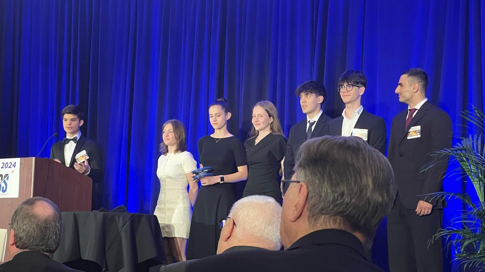
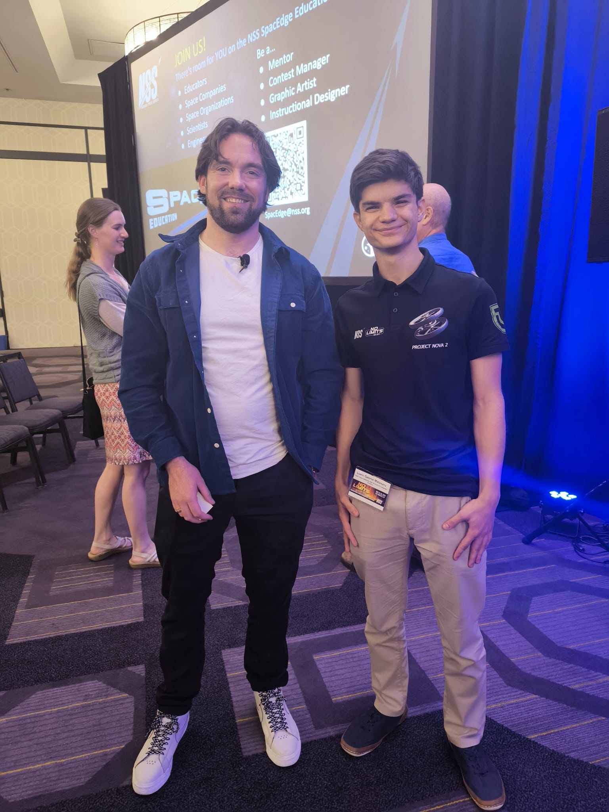

The NSS Space Settlement Contest is an international competition organised by the [National Space Society](https://nss.org/) with over 1000 participating teams yearly. It challenges K-12 students to design a fully self-sufficient space colony for the near or distant future.
The design considerations must be detailed in a 50-page report submitted to the competition.

I was part of a 12-member team, and was responsible for the structure, 3D models and renders of our space settlement. 
The design was shaped by requirements found in existing scientific literature as well as our own simulations and stability calculations.

Our project, [Nova 2](https://nss.org/nss-space-settlement-contest/past-winners/), won the Grand Prize in 2024.

As such, we were invited to the International Space Development Conference (ISDC) to present our project in front of an audience of seasoned space researchers, engineers, entrepreneurs and educators. Even some astronauts!

I got to meet some incredible people such as Brian McManus from Real Engineering (one of my all-time favourite YouTube channels):

The few days we got to spend at ISDC were some of the most stressful of my high school years, but also some of the most inspiring. I could not help but leave the conference with a rekindled passion for space exploration.